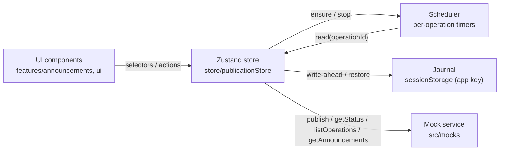

# Announcement Publishing Workspace

[](https://github.com/mjkohan/announcement-publishing-workspace/actions/workflows/ci.yml)

**Live demo:** https://mjkohan.github.io/announcement-publishing-workspace/

A React + TypeScript workspace that publishes one of three announcements through a simulated service, follows each attempt to its outcome, and recovers safely after failures or a page refresh, without creating duplicate publications.

The original brief is in [docs/ASSIGNMENT.md](docs/ASSIGNMENT.md). Each requirement is mapped to its code and tests in [docs/requirements-traceability.md](docs/requirements-traceability.md).

## Quick start

Requires Node.js 26 (see `.nvmrc`) and npm.

```sh
nvm use
npm ci
npm run dev
```

## Scripts

| Script                                | What it does                                                       |
| ------------------------------------- | ------------------------------------------------------------------ |
| `npm run dev`                         | Vite dev server                                                    |
| `npm run build`                       | Type-check (`tsc -b`) and production build                         |
| `npm run preview`                     | Serve the production build                                         |
| `npm run typecheck`                   | TypeScript only                                                    |
| `npm run lint` / `lint:fix`           | ESLint                                                             |
| `npm run format` / `format:check`     | Prettier                                                           |
| `npm test` (`test:watch`, `coverage`) | Vitest (jsdom); any `console.error` or `console.warn` fails a test |
| `npm run test:e2e` (`test:e2e:ui`)    | Playwright (builds the app and serves it on port 4173)             |
| `npm run check`                       | `typecheck` + `lint` + `format:check` + `test`                     |

### Git hooks

Husky installs the hooks on `npm install` (`prepare` script).

| Hook         | Runs                                                                           |
| ------------ | ------------------------------------------------------------------------------ |
| `pre-commit` | lint-staged: ESLint `--fix` and Prettier on staged files (`src/mocks` skipped) |
| `commit-msg` | commitlint, Conventional Commits, header max 100 characters                    |
| `pre-push`   | `npm run typecheck && npm test`                                                |

CI (`.github/workflows/ci.yml`) runs `check` and `build`, then Playwright on Chromium (the report is uploaded when it fails), plus commitlint on pull requests.

## Trying the scenarios

Open **Simulation controls** at the bottom of the page, pick a scenario, then press **Publish**. The scenario applies to new operations only. **Reset simulation** clears all service records and attempts.

| Scenario               | Steps                      | Expected result                                                                                                        | After a refresh                                                                             |
| ---------------------- | -------------------------- | ---------------------------------------------------------------------------------------------------------------------- | ------------------------------------------------------------------------------------------- |
| `success`              | Publish                    | Sending… → Processing → Published (about 2.5 s), with the publication ID                                               | Same attempt is read again ("Checking status…") and ends Published. No new publish          |
| `explicit-rejection`   | Publish                    | Rejected, with the service reason. **Start new attempt…** asks for confirmation, then sends a new operationId          | Rejected stays, with the reason; a new attempt is still possible                            |
| `lost-response`        | Publish                    | Outcome unknown (reply lost), then polling finds Processing → Published. **Retry same attempt** reuses the operationId | Attempt is followed to Published; "Attempts (1)"                                            |
| `status-check-failure` | Publish                    | Outcome unknown; the first status read fails, polling backs off and retries, then Published                            | The restore list read may fail once and is retried (500 ms); then Published                 |
| `overlapping`          | Publish all three, quickly | Each announcement has its own timing (2 s, 6 s, 10 s); replies arrive out of order; each ends Published on its own     | All three are followed independently; one attempt each                                      |
| `slow-response`        | Publish                    | Polling shows Published before the late publish reply (4.5 s); the late "processing" reply does not undo it            | Refresh during "Sending…": the same attempt is followed to Published, never published again |

## Architecture



The scheduler owns timers only: when one fires, it asks the store to read, and the store makes the (deduplicated) `getStatus` call.

Components never call the service and own no timers. All side effects live in the store; the only component timer is the presentational tick in `RelativeTime`.

```text
src/
  app/                    App shell, ServiceProvider (creates the store), hooks, ErrorBoundary
  domain/                 Pure types and logic: derive.ts (views), merge.ts (snapshots), operationId.ts, errors.ts
  persistence/journal.ts  Write-ahead journal in sessionStorage (own key)
  store/                  publicationStore.ts, scheduler.ts, selectors.ts
  features/announcements/ List, detail, status card, actions, attempt history, restore banner
  ui/                     Shared presentational components (Button, Banner, ConfirmDialog, ...)
  dev/                    Simulation controls (scenario switcher, reset)
  mocks/                  Supplied mock service, unchanged
  test/                   Test setup and helpers
tests/                    Integration tests (Vitest + Testing Library)
e2e/                      Playwright specs, including axe accessibility checks
```

## State model

- **Operations, not announcements.** State is a map keyed by `operationId`. Each entry holds the last accepted snapshot, `lastError`, and two independent flags: `publishInFlight` and `checkInFlight` (a status read can overlap the publish request).
- **Derived views.** An announcement's view is computed from its attempts, never stored (`domain/derive.ts`): any published attempt wins; otherwise the latest attempt decides: `rejected`, `processing` (marked stale after a failed read), `unconfirmed` (a real request failed, no snapshot), `submitting`, or `checking` (restored from the journal, first read pending).
- **Merge rules** (`domain/merge.ts`): accept a snapshot only if `incoming.version >= current.version`; version 2 (published or rejected) is immutable. Errors live in `lastError` and never erase a snapshot.
- **Anti-duplicate rule.** A new operationId is created only from `idle`, or from a confirmed `rejected` after a confirmation dialog, and only when no attempt of that announcement is unresolved. Retries reuse the same operationId. Nothing publishes automatically after a refresh.
- **Epoch.** A counter bumped by **Reset simulation**. After every `await`, the store checks the epoch and drops results from an older epoch.

## Technical decisions

- **Zustand vanilla store (`createStore` + `useStore`).** Service calls and timers live outside React, so StrictMode double effects cannot duplicate requests, and the store is testable without rendering.
- **Keyed by `operationId`.** The service reports per operation and replies arrive out of order; one record per operation keeps them independent.
- **Version-based merge.** Late or out-of-order snapshots (e.g. a slow publish reply) can never move an operation backwards.
- **Per-operation polling with backoff, plus manual check.** One `setTimeout` loop per unresolved operation: every 1.5 s, after failures 1 s, 2 s, 4 s, 8 s, then 10 s. Paused while the tab is hidden; reads at once when it is visible again. **Check status** joins the read already in flight instead of sending a second one.
- **Write-ahead journal.** The attempt is written to sessionStorage before `service.publish` is called, so a refresh at any moment can find it and recover by reading, never by publishing. If the write fails, the publish is not sent.
- **`erasableSyntaxOnly` off in `tsconfig.app.json`.** `src/mocks/service.ts` uses constructor parameter properties, and the supplied mocks must stay unchanged.
- **Supplied mocks untouched.** `src/mocks` is excluded from ESLint and Prettier and marked `-text` in `.gitattributes`; the app uses only the public API from `src/mocks/index.ts`.
- **Husky + commitlint.** Small Conventional Commits, checked locally and in CI, and type-check + tests before every push.

## Assumptions

- One tab. The journal is per-tab sessionStorage; other tabs are not coordinated.
- The service is the source of truth. On restore, `listOperations` adds operations the journal does not know.
- One published attempt means the announcement is published.
- A new attempt is allowed only after a confirmed rejection, and only after the user confirms it.
- Publishing is paused until the restore after a refresh finishes (or is retried after it fails).
- Polling and backoff intervals are product choices, not service requirements.
- An unknown publish error means "outcome unknown", never "failed". A failed status read never means "rejected".

## Known limitations and next steps

- **Cross-tab:** two tabs can each start an attempt. Next: coordinate through `BroadcastChannel` (or a shared journal in `localStorage`).
- **Push updates:** status comes from polling. Next: SSE or WebSocket from the service, with polling as a fallback.
- **Offline:** no offline detection. With a real network service, requests would just fail and back off. Next: pause on `navigator.onLine === false` and resume on `online`.
- **i18n:** UI text is English only and inline. Next: extract strings and format dates per locale.

## AI usage

This project was built with Claude Code as a coding assistant, working under the rules in [CLAUDE.md](CLAUDE.md).
